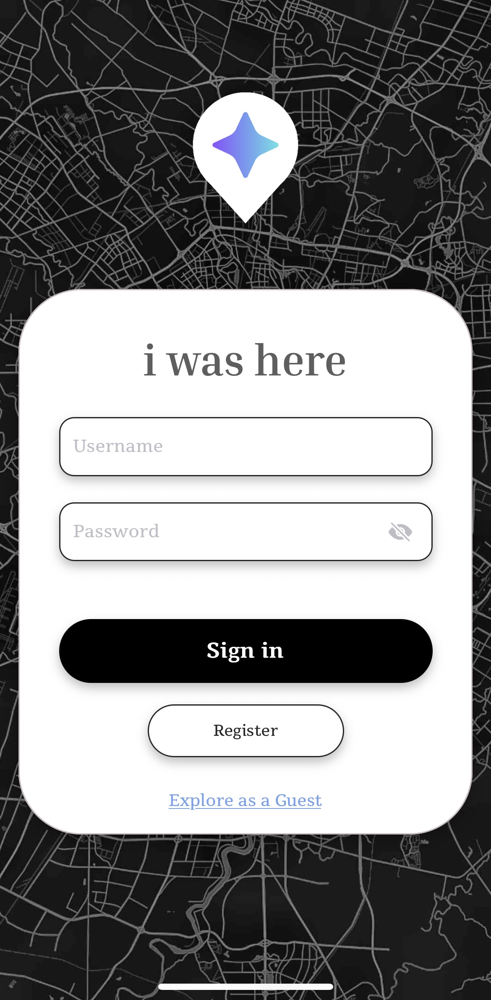
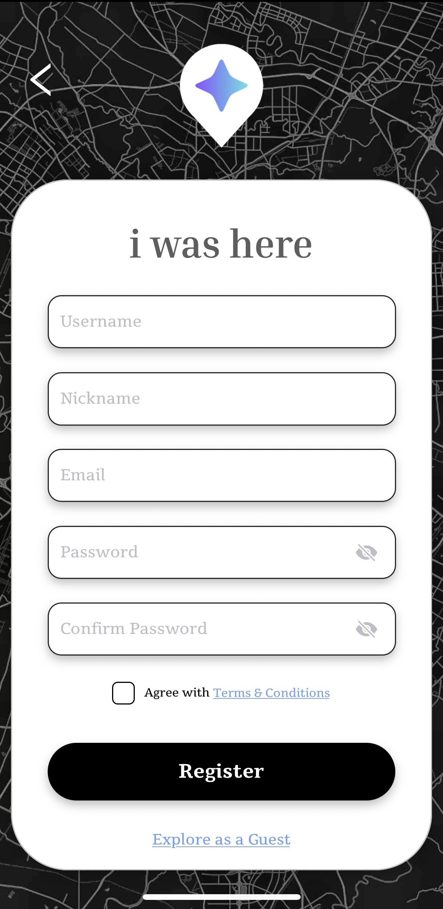
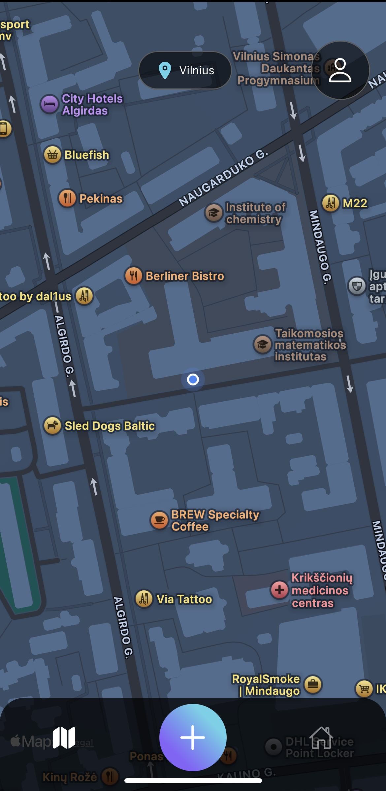
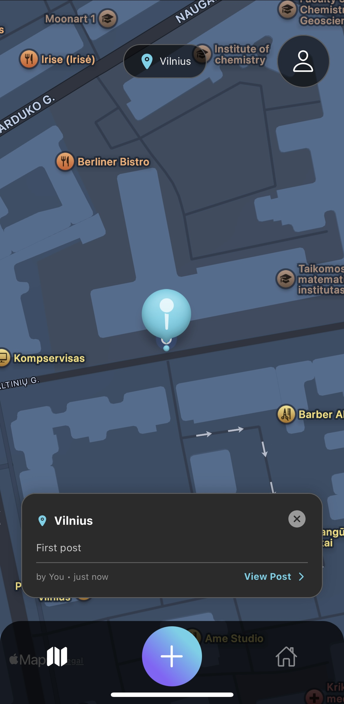
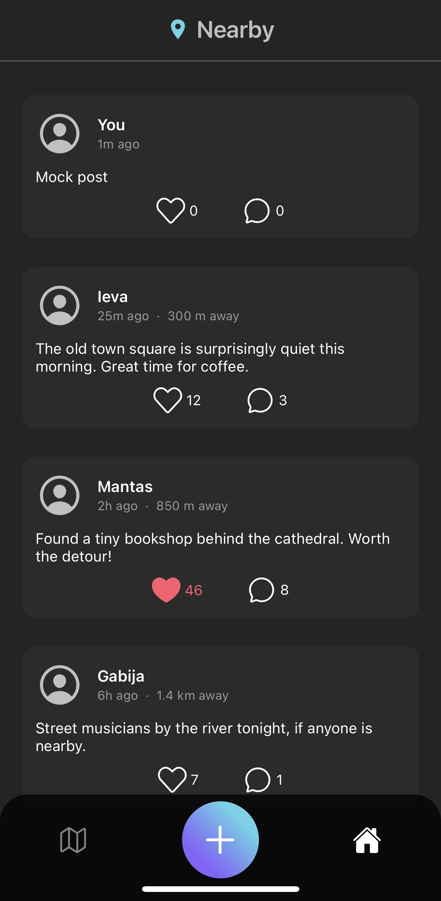
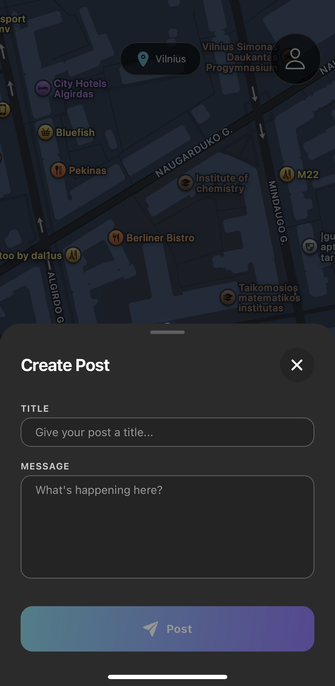

# I Was Here - Frontend

## Overview

I Was Here is a mobile application developed as part of a university group project. 
It allows users to mark and share places they have visited through an interactive map. 

## Technologies Used

* **Language:** TypeScript
* **Framework:** React Native
* **Platform:** Expo
* **Navigation:** Expo Router
* **Version Control:** Git and GitHub

## Features

* **User Authentication:** Login and registration screens.
* **Interactive Map:** View and explore places through a map interface.
* **Location Markers:** Mark and view visited locations.
* **Feed:** Browse posts shared by other users.
* **Posts:** View individual posts and their associated locations.


## My Contribution

I contriputed to the frontend development as part of a university group project, collaborating with other team members.
My contributions include:
* Implementing login and registration interfaces.
* Developing the map screen and location marker functionality.
* Creating the feed page.
* Implementing application navigation.
* Integrating frontend components with backend services.

## Preview

<div style="display: flex; overflow-x: auto; gap: 10px;">
  
  
  
  
  
  
</div>

## Project Status

This repository contains my individual frontend implementation from the original university group project.

The original backend is not available in this repository, so features requiring backend connectivity, such as authentication and data persistence, may not work as intended.

## How To View

### Prerequisites

* Node.js
* npm
* Expo Go or an Android/iOS development environment

### Instalation

1. Clone repository

  ```bash
   git clone https://github.com/vaivaeva201/i-was-here-frontend.git
   ```

2. Navigate to the project directory:
 ```bash
    cd i-was-here-frontend
```
3. Install dependencies:
```bash
    npm install
```
4.  Start the development server:
```bash
    npx expo start
```

Follow the Expo CLI instructions to open the application on a supported device or emulator.